# Smart Building Sensor Monitoring System

**Author: Maral Torabi | Student ID: 40213312**

A modular, enterprise-grade, object-oriented Python application designed for monitoring smart facility infrastructures, analyzing environmental sensor telemetry, evaluating multi-tiered threshold anomalies, tracking hardware lifecycles, and dispatching multi-channel facility alerts.

The codebase is engineered with strict separation of concerns, strong typing, clean domain abstractions, and distinct per-entity module files optimized for **UML reverse engineering** (e.g., Software Ideas Modeler) and **round-trip software engineering**.

---

## 1. Project Overview

Modern smart buildings rely on hundreds of distributed sensor endpoints (monitoring temperature, humidity, carbon dioxide concentration, occupancy motion, and electrical power consumption) across multiple building floors and rooms. 

The **Smart Building Sensor Monitoring System** provides:
* **Spatial Facility Modeling**: Full physical containment hierarchy representing Buildings, Floors, and Rooms.
* **Polymorphic Sensor Hierarchy**: Abstract and specialized sensor implementations for distinct telemetry metrics and automated reading generation.
* **Real-Time Stream Monitoring**: Continuous rule-based threshold evaluation against warning and critical boundaries.
* **Device Health & Offline Detection**: Automatic heartbeat tracking that flags unresponsive sensors as `OFFLINE` and triggers critical alarms.
* **Alert Lifecycle Management**: Comprehensive incident lifecycle tracking across `OPEN`, `ACKNOWLEDGED`, and `RESOLVED` states.
* **Pluggable Notifications**: Decoupled delivery mechanisms (Console, Email) adhering to the Dependency Inversion Principle.
* **Facility Analytics & Reporting**: Statistical metrics calculation (min, max, average) and executive health summary reports.

---

## 2. Layered Architecture

The system follows a strict **Layered Architecture** ensuring loose coupling, high cohesion, and testability:

```
+-------------------------------------------------------------------------+
|                           Presentation Layer                            |
|                     (main.py / CLI / Application Demo)                  |
+-------------------------------------------------------------------------+
                                     |
                                     v
+-------------------------------------------------------------------------+
|                              Service Layer                              |
|         (MonitoringService, AlertService, ReportingService, etc.)       |
+-------------------------------------------------------------------------+
                   |                                     |
                   v                                     v
+------------------------------------+    +-------------------------------+
|          Repository Layer          |    |      Notification Service     |
|   (Repository[T], Memory Repos)    |    |  (Interface & Implementations)|
+------------------------------------+    +-------------------------------+
                   |
                   v
+-------------------------------------------------------------------------+
|                               Domain Layer                              |
|  - Spatial Models: Building, Floor, Room                                |
|  - Sensor Hierarchy: Sensor, Temperature, Humidity, CO2, Motion, Energy |
|  - Telemetry & Incidents: SensorReading, Alert                          |
|  - Enumerations: SensorStatus, AlertSeverity, AlertStatus               |
+-------------------------------------------------------------------------+
```

1. **Domain Layer (`src/domain/`)**: Pure domain models, business logic, and entity definitions with zero external framework dependencies.
2. **Repository Layer (`src/repository/`)**: Data persistence abstraction utilizing the Generic Repository Pattern (`Repository[T]`), decoupling domain operations from data stores.
3. **Service Layer (`src/service/`)**: Orchestrates business workflows, stream processing, threshold analysis, device heartbeat auditing, and diagnostic reports.
4. **Notification Layer (`src/service/notification.py`)**: Abstract delivery contract enabling pluggable notification sinks (Console, SMTP Email, etc.).

---

## 3. Directory Structure

```
smart_building/
├── src/
│   ├── __init__.py
│   ├── domain/
│   │   ├── __init__.py          # Domain package exports (__all__)
│   │   ├── enums.py             # SensorStatus, AlertSeverity, AlertStatus
│   │   ├── sensor_reading.py    # SensorReading entity & unit conversions
│   │   ├── sensor.py            # Sensor (ABC), Temperature, Humidity, CO2, Motion, Energy
│   │   ├── alert.py             # Alert entity & lifecycle management
│   │   ├── room.py              # Room spatial model & sensor aggregation
│   │   ├── floor.py             # Floor spatial model & room containment
│   │   └── building.py          # Building spatial model & floor composite
│   ├── repository/
│   │   ├── __init__.py          # Repository package exports
│   │   ├── base.py              # Generic Repository[T] abstract interface
│   │   └── memory.py            # InMemoryRepository, SensorRepo, ReadingRepo, AlertRepo
│   ├── service/
│   │   ├── __init__.py          # Service package exports
│   │   ├── monitoring.py        # MonitoringService & ThresholdRule
│   │   ├── alert.py             # AlertService lifecycle management
│   │   ├── notification.py      # NotificationService interface & implementations
│   │   └── reporting.py         # ReportingService metric analytics & reports
│   └── main.py                  # End-to-end simulation entry point
├── tests/
│   ├── __init__.py
│   ├── test_sensors.py          # Sensor hierarchy and unit conversion tests
│   ├── test_monitoring.py       # Threshold evaluation, alerts, & reporting tests
│   └── test_repositories.py     # Generic CRUD & specialized query tests
├── requirements.txt
└── README.md
```

---

## 4. Installation & Setup

### Prerequisites
* Python 3.9 or higher (tested on Python 3.10+)
* `pip` package manager

### 1. Clone or Navigate to the Project
```bash
cd project_1_40213312
```

### 2. (Optional) Create and Activate a Virtual Environment
```bash
# Create virtual environment
python -m venv venv

# Activate on Windows (PowerShell):
.\venv\Scripts\Activate.ps1

# Activate on Linux/macOS:
source venv/bin/activate
```

### 3. Install Dependencies
```bash
pip install -r smart_building/requirements.txt
```

---

## 5. How to Run the Application

Execute the end-to-end demonstration script:

```bash
python smart_building/src/main.py
```

### Demonstration Scenario Highlights
When `main.py` is executed, it automatically performs the following actions:
1. **Physical Facility Setup**: Instantiates `Building` ("Innovation Tower"), adds `Floor 2`, and provisions rooms (`Server Room`, `Executive Boardroom`).
2. **Sensor Deployment**: Instantiates and attaches 5 specialized sensors (`TemperatureSensor`, `HumiditySensor`, `CO2Sensor`, `MotionSensor`, `EnergySensor`) to rooms and registers them in the repository.
3. **Nominal Ingestion**: Captures and processes normal operational telemetry without triggering alerts.
4. **Threshold Anomaly Simulation**:
   - Ingests **38.5°C** reading from the Server Room -> Triggers **CRITICAL Alert**.
   - Ingests **1250 ppm** CO₂ reading from the Boardroom -> Triggers **WARNING Alert**.
5. **Real-time Notifications**: `ConsoleNotificationService` logs formatted alerts to stdout.
6. **Incident Remediation**: Demonstrates the workflow of acknowledging and resolving active alerts.
7. **Diagnostic Facility Reports**: `ReportingService` computes sensor telemetry statistics (min, max, average) and full building health assessments.

---

## 6. How to Run Tests

The test suite covers unit tests for all domain models, repositories, and services using `pytest`:

```bash
pytest
```

For verbose output with individual test execution details:
```bash
pytest -v
```

---

## 7. Main Domain Entities & Components

| Entity / Class | Layer | Description |
|---|---|---|
| `Building` | Domain | Represents an entire physical building; composites multiple `Floor` objects. |
| `Floor` | Domain | Represents a level within a building; composites multiple `Room` objects. |
| `Room` | Domain | Physical container that aggregates multiple `Sensor` instances. |
| `Sensor` (ABC) | Domain | Abstract base class managing sensor identity, status, heartbeat, and reading production. |
| `TemperatureSensor` | Domain | Specialized sensor for ambient temperature monitoring in Celsius (`C`). |
| `HumiditySensor` | Domain | Specialized sensor for relative humidity monitoring in percentage (`%`). |
| `CO2Sensor` | Domain | Specialized sensor for Carbon Dioxide concentration monitoring in ppm (`ppm`). |
| `MotionSensor` | Domain | Specialized sensor for occupancy/motion detection (`motion`). |
| `EnergySensor` | Domain | Specialized sensor for power consumption in kilowatt-hours (`kWh`). |
| `SensorReading` | Domain | Immutable record of a measurement with validation and unit conversion methods. |
| `Alert` | Domain | Models operational violations and tracks lifecycle states (`OPEN`, `ACKNOWLEDGED`, `RESOLVED`). |
| `Repository[T]` (ABC) | Repository | Generic CRUD abstract interface defining standard data access contracts. |
| `InMemoryRepository[T]` | Repository | Generic dictionary-backed repository implementation. |
| `SensorRepository` | Repository | Specialized repository with queries by room, status, and health. |
| `ReadingRepository` | Repository | Specialized repository with queries by sensor and timestamp filtering. |
| `AlertRepository` | Repository | Specialized repository with queries by sensor, severity, and status. |
| `NotificationService` (ABC) | Service | Abstract interface for dispatching notifications to stakeholders. |
| `ConsoleNotificationService` | Service | Concrete notification delivery printing formatted messages to standard output. |
| `EmailNotificationService` | Service | Concrete notification delivery simulating SMTP email dispatching. |
| `MonitoringService` | Service | Stream processing engine evaluating telemetry against threshold rules and detecting offline devices. |
| `AlertService` | Service | Manages creation, acknowledgment, and resolution of alerts with automated dispatch. |
| `ReportingService` | Service | Generates mathematical aggregations and comprehensive diagnostic health reports. |

---

## 8. UML Class Diagram - Designed by Maral Torabi (Student ID: 40213312)

```mermaid
classDiagram
    direction TB

    %% Enums
    class SensorStatus {
        <<enumeration>>
        ONLINE
        OFFLINE
        MAINTENANCE
        DISABLED
    }

    class AlertSeverity {
        <<enumeration>>
        INFO
        WARNING
        CRITICAL
    }

    class AlertStatus {
        <<enumeration>>
        OPEN
        ACKNOWLEDGED
        RESOLVED
    }

    %% Domain Entities
    class SensorReading {
        +str id
        +str sensor_id
        +datetime timestamp
        +float value
        +str unit
        +is_valid() bool
        +convert_unit(str target_unit) float
    }

    class Sensor {
        <<abstract>>
        +str id
        +str name
        +str unit
        +Optional~str~ room_id
        +SensorStatus status
        +Optional~datetime~ last_reading_time
        +bool enabled
        #Optional~float~ _simulated_value
        +read_value()* float
        +create_reading(Optional~str~ reading_id) SensorReading
        +is_online() bool
        +enable() None
        +disable() None
        +set_simulated_value(Optional~float~ value) None
    }

    class TemperatureSensor {
        +read_value() float
    }

    class HumiditySensor {
        +read_value() float
    }

    class CO2Sensor {
        +read_value() float
    }

    class MotionSensor {
        +read_value() float
    }

    class EnergySensor {
        +read_value() float
    }

    class Room {
        +str id
        +str name
        +int floor_number
        +List~Sensor~ sensors
        +add_sensor(Sensor sensor) None
        +remove_sensor(str sensor_id) bool
        +get_sensor(str sensor_id) Optional~Sensor~
    }

    class Floor {
        +str id
        +int number
        +List~Room~ rooms
        +Optional~str~ building_id
        +add_room(Room room) None
        +remove_room(str room_id) bool
        +get_room(str room_id) Optional~Room~
    }

    class Building {
        +str id
        +str name
        +str address
        +List~Floor~ floors
        +add_floor(Floor floor) None
        +remove_floor(str floor_id) bool
        +get_floor(str floor_id) Optional~Floor~
        +get_all_sensors() List~Sensor~
    }

    class Alert {
        +str id
        +str sensor_id
        +Optional~str~ reading_id
        +str message
        +AlertSeverity severity
        +AlertStatus status
        +datetime created_at
        +Optional~datetime~ acknowledged_at
        +Optional~datetime~ resolved_at
        +acknowledge(Optional~datetime~ timestamp) None
        +resolve(Optional~datetime~ timestamp) None
        +reopen() None
    }

    %% Repository Pattern Layer
    class Repository~T~ {
        <<interface>>
        +add(T entity)* None
        +get_by_id(str id)* Optional~T~
        +get_all()* List~T~
        +update(T entity)* bool
        +delete(str id)* bool
    }

    class InMemoryRepository~T~ {
        #Dict~str, T~ _storage
        +add(T entity) None
        +get_by_id(str id) Optional~T~
        +get_all() List~T~
        +update(T entity) bool
        +delete(str id) bool
        +clear() None
        +count() int
    }

    class SensorRepository {
        +get_by_room_id(str room_id) List~Sensor~
        +get_by_status(SensorStatus status) List~Sensor~
        +get_offline_sensors() List~Sensor~
        +get_enabled_sensors() List~Sensor~
    }

    class ReadingRepository {
        +get_by_sensor_id(str sensor_id) List~SensorReading~
        +get_latest_reading(str sensor_id) Optional~SensorReading~
        +get_readings_since(str sensor_id, datetime since) List~SensorReading~
    }

    class AlertRepository {
        +get_by_sensor_id(str sensor_id) List~Alert~
        +get_by_status(AlertStatus status) List~Alert~
        +get_by_severity(AlertSeverity severity) List~Alert~
        +get_open_alerts() List~Alert~
    }

    %% Service Layer
    class NotificationService {
        <<interface>>
        +send_notification(str message, str recipient, AlertSeverity severity)* bool
    }

    class ConsoleNotificationService {
        +List~dict~ history
        +send_notification(str message, str recipient, AlertSeverity severity) bool
    }

    class EmailNotificationService {
        +str smtp_host
        +str sender_email
        +List~dict~ sent_emails
        +send_notification(str message, str recipient, AlertSeverity severity) bool
    }

    class AlertService {
        +AlertRepository alert_repository
        +Optional~NotificationService~ notification_service
        +str notification_recipient
        +create_alert(str sensor_id, str message, AlertSeverity severity, Optional~str~ reading_id) Alert
        +acknowledge_alert(str alert_id) Optional~Alert~
        +resolve_alert(str alert_id) Optional~Alert~
        +get_open_alerts() List~Alert~
        +get_critical_alerts() List~Alert~
        +get_alerts_for_sensor(str sensor_id) List~Alert~
    }

    class ThresholdRule {
        +Optional~float~ warning_min
        +Optional~float~ warning_max
        +Optional~float~ critical_min
        +Optional~float~ critical_max
    }

    class MonitoringService {
        +SensorRepository sensor_repository
        +ReadingRepository reading_repository
        +AlertService alert_service
        +Dict~str, ThresholdRule~ rules
        +set_threshold_rule(str unit, ThresholdRule rule) None
        +process_reading(SensorReading reading) Optional~Alert~
        +check_threshold(SensorReading reading) Optional~Tuple~
        +create_alert_if_needed(SensorReading reading) Optional~Alert~
        +detect_offline_sensor(float timeout_seconds) List~Alert~
    }

    class ReportingService {
        +SensorRepository sensor_repository
        +ReadingRepository reading_repository
        +AlertRepository alert_repository
        +calculate_average_reading(str sensor_id) Optional~float~
        +calculate_min_reading(str sensor_id) Optional~float~
        +calculate_max_reading(str sensor_id) Optional~float~
        +generate_sensor_report(str sensor_id) Dict
        +generate_room_report(Room room) Dict
        +generate_building_report(Building building) Dict
    }

    %% Relationships - Inheritance
    Sensor <|-- TemperatureSensor
    Sensor <|-- HumiditySensor
    Sensor <|-- CO2Sensor
    Sensor <|-- MotionSensor
    Sensor <|-- EnergySensor

    NotificationService <|-- ConsoleNotificationService
    NotificationService <|-- EmailNotificationService

    Repository <|-- InMemoryRepository
    InMemoryRepository <|-- SensorRepository
    InMemoryRepository <|-- ReadingRepository
    InMemoryRepository <|-- AlertRepository

    %% Relationships - Composition & Aggregation
    Building *-- "1..*" Floor : contains
    Floor *-- "1..*" Room : contains
    Room o-- "0..*" Sensor : installs

    %% Relationships - Associations & Class State
    Sensor --> SensorStatus : status
    Alert --> AlertSeverity : severity
    Alert --> AlertStatus : status

    MonitoringService --> SensorRepository : manages
    MonitoringService --> ReadingRepository : records
    MonitoringService --> AlertService : triggers
    MonitoringService *-- ThresholdRule : applies

    AlertService --> AlertRepository : stores
    AlertService --> NotificationService : notifies

    ReportingService --> SensorRepository : queries
    ReportingService --> ReadingRepository : queries
    ReportingService --> AlertRepository : queries

    %% Relationships - Dependencies
    Sensor ..> SensorReading : creates
    MonitoringService ..> SensorReading : processes
    MonitoringService ..> Alert : creates
    AlertService ..> Alert : creates
    ReportingService ..> Building : analyzes
    ReportingService ..> Room : analyzes
```


